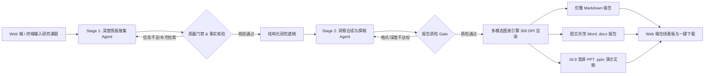

# Insight Synthesis Crew | 深度研究与咨询级报告合成智能体系统

<p align="center">
  <a href="https://www.python.org/"></a>
  <a href="https://crewai.com/"></a>
  <a href="https://www.deepseek.com/"></a>
  <a href="https://serper.dev/"></a>
  <a href="https://streamlit.io/"></a>
  <a href="https://matplotlib.org/"></a>
  <a href="https://github.com/scanny/python-pptx"></a>
  <a href="LICENSE"></a>
</p>

**Insight Synthesis Crew** 是一个基于 **CrewAI** 与 **DeepSeek-V4.1-Flash** 构建的**两阶段协同深度研究与全格式报告合成系统**。系统通过模拟专业咨询机构的分工机制，将“广度情报搜集与多源交叉验证”与“深度逻辑综合与咨询级文档排版”解耦，内置自愈式质量门禁（Quality Gate），配备交互式 Web 控制台，支持一键全自动生成高可读 Markdown、内嵌高清图表的商务级 Word (`.docx`) 及 16:9 咨询级宽屏 PowerPoint (`.pptx`) 汇报演示文稿。

---

## ✨ 核心特性

- **🌐 交互式 Web 控制台（Insight Synthesis Studio）**
  - 提供开箱即用的现代化商务界面，支持一键加载精选标杆课题、实时流式查看双阶段研究进展、在线预览 300 DPI 趋势图表及一键打包下载全套产物。
- **🔄 两阶段智能体协同架构（Two-Stage Pipeline）**
  - **第一阶段（广度检索与去噪核验）**：情报检索智能体聚焦多维度信息挖掘、关键客观量化数据提取、事实交叉核验与信源记录，输出高信息密度的结构化研究底稿。
  - **第二阶段（洞察合成与咨询级撰稿）**：首席主笔智能体基于核验后的底稿，提炼核心商业/学术洞察与关键指标序列，按麦肯锡金字塔原理完成深度报告撰写与结构化排版。
- **🛡️ 自愈式质量门禁（Self-Healing Quality Gate）**
  - 内置输出质量评估与自动重试/补偿机制，对论据完整性、信源可追溯性及格式合规性进行自动化质检，杜绝大模型“幻觉”与敷衍输出。
- **📈 多模态行业图表与数据可视化引擎（Chart Engine）**
  - 自动从研究报告中提炼核心量化指标（如市场规模、年复合增长率、出货量、渗透率），以 300 DPI 高清分辨率绘制 McKinsey / BCG 风格商务折线趋势图与对比柱状图，自动同步内嵌至 Word 与 PPTX。
- **📊 三位一体咨询交付矩阵（Markdown & Word & 16:9 PPTX）**
  - **优雅 Markdown**：结构清晰、格式规整，包含本地图表相对链接，即时可在任意 Markdown 编辑器或网页中渲染。
  - **战略级 Word (.docx)**：含多级标题体系、高亮执行摘要卡片、嵌入式高清趋势图表、风险警戒点、战略路线与四列格式化引用源数据表格。
  - **16:9 宽屏商业 PPT (.pptx)**：采用麦肯锡/BCG 风格经典 Slate & Royal Blue 配色，包含封面幻灯片、执行摘要看板、三列关键洞察卡片网格、**图文对照量化趋势研判页**、潜在风险警示页、行动建议路线页及权威来源背书页，并在生成完成后自动唤起 Microsoft PowerPoint。
- **⚡ 极致性价比与高吞吐驱动**
  - 深度适配 **DeepSeek-V4.1-Flash** 模型，在保持长文本深度推理能力的同时，大幅降低多轮 Agent 交互的 Token 成本与响应延迟。
- **🧰 现代化 Python 工程规范**
  - 采用 `uv` 进行极速依赖与虚拟环境管理，配置与代码分离（`config/` + `src/`），历史课题全套产物永久沉淀（`reports/archive/`），并提供完整的单元测试套件。

---

## 🏗️ 系统工作流架构



### 最小权限隔离与安全设计原则（Least Privilege）

```
                       用户输入研究课题 (Topic)
                                  │
                                  ▼
     ┌────────────────────────────────────────────────────────┐
     │  Phase 1: Scout Agent (高级情报搜寻员)                  │
     │  • 模型: DeepSeek-V4.1-Flash (极速、长上下文)           │
     │  • 挂载工具: Google 关键词搜索 (Serper) + 网页抓取爬虫   │
     │  • 约束控制: max_iter=8, max_rpm=15, 禁止递归委派        │
     └────────────────────────────┬───────────────────────────┘
                                  │ 结构化事实证据链 & 引用来源清单
                                  ▼
                     【门禁路由质检 Quality Gate】
                    (信息丰度/来源不足则触发自愈重试)
                                  │ 质检通过
                                  ▼
     ┌────────────────────────────────────────────────────────┐
     │  Phase 2: Analyst Agent (高级战略分析与核验员)         │
     │  • 模型: DeepSeek-V4.1-Flash                           │
     │  • 严格工具隔离: 仅允许本地受控文件读取，阻断公网搜索    │
     │  • 约束控制: max_iter=5, 消除外网幻觉与发散             │
     │  • 交付规格: Pydantic 结构化输出 (含趋势图表量化数据)   │
     └────────────────────────────┬───────────────────────────┘
                                  │
                                  ▼
     ┌────────────────────────────────────────────────────────┐
     │              三轨全自动归档、排版与系统唤起             │
     │  1. Markdown 优雅排版 (含图表相对链接)                  │
     │  2. 商务级排版 Word (.docx，嵌入 300 DPI 图表并唤起)   │
     │  3. 16:9 宽屏 PPT (.pptx，含图文对照幻灯片并唤起)      │
     │  4. 交互式 Web 控制台 (在线看板、图表直显与打包下载)    │
     └────────────────────────────────────────────────────────┘
```

---

## 📂 完整目录结构

```
.
├── config/
│   ├── agents.yaml           # Agent 角色设定、目标、LLM 模型与限流策略
│   └── tasks.yaml            # 阶段一与阶段二任务流、上下文依赖与图表提示词约束
├── src/
│   └── craw/
│       ├── __init__.py
│       ├── crew.py           # CrewBase 编排：Agent 组装、工具受限绑定与 Guardrail
│       ├── flow.py           # AdvancedTwoStageFlow：带质量门禁自愈重试的工作流
│       ├── export_docx.py    # 商务级 Word (.docx) 导出引擎与归档路径管理
│       ├── export_pptx.py    # 16:9 咨询级宽屏 PowerPoint (.pptx) 演示文稿生成引擎
│       ├── export_charts.py  # 300 DPI 商务咨询图表自动渲染引擎
│       └── models.py         # Pydantic 报告、量化图表与引用源数据模型
├── reports/
│   ├── archive/              # 📂 历史所有课题全格式永久归档目录 (永不覆盖)
│   │   ├── 20261022_123900_低空经济在物流配送场景.docx
│   │   ├── 20261022_123900_低空经济在物流配送场景.pptx
│   │   ├── 20261022_123900_低空经济在物流配送场景.png
│   │   └── 20261022_123900_低空经济在物流配送场景.md
│   ├── research_report.docx  # 📄 最新一次执行的 Word 报告镜像
│   ├── research_report.pptx  # 🖥️ 最新一次执行的 16:9 PPT 报告镜像
│   ├── research_report_chart.png # 📈 最新一次执行的高清图表镜像
│   └── research_report.md    # 📝 最新一次执行的 Markdown 简报镜像
├── tests/
│   ├── test_crew_setup.py    # 工具安全隔离与权限边界自动化测试
│   ├── test_flow_structure.py# Flow 状态生命周期与路由逻辑验证
│   └── test_export.py        # Word/PPTX/图表全格式离线导出与渲染自动化测试
├── .env.example              # 环境变量与 API 密钥模版 (已脱敏)
├── LICENSE                   # MIT 开源许可证
├── app.py                    # 🌐 Streamlit 交互式 Web 控制台
├── main.py                   # 命令行多模式统一运行入口
└── pyproject.toml            # uv 依赖管理配置
```

---

## 🚀 快速上手

### 1. 安装与环境准备

项目使用极速包管理工具 `uv`：

```bash
# 克隆仓库
git clone https://github.com/sxxcwj/insight-synthesis-crew.git
cd insight-synthesis-crew

# 复制密钥配置模版
cp .env.example .env
```

在 `.env` 中填入您的密钥：
```env
# 核心大模型（默认 DeepSeek）
DEEPSEEK_API_KEY=your_deepseek_api_key

# 搜索引擎（阶段一 Google 全网检索，可选，推荐配置）
SERPER_API_KEY=your_serper_api_key
```

### 2. 运行架构、安全隔离与导出测试

验证 Agent 工具隔离（Analyst 绝无搜索工具、调用轮次不超过阈值）及全格式图文渲染：

```bash
uv run python tests/test_crew_setup.py
uv run python tests/test_flow_structure.py
uv run python tests/test_export.py
```

### 3. 执行研究任务

系统支持多种执行模式：

#### 模式 A：交互式 Web 战略控制台（推荐 · 最佳视觉与交互体验）
启动本地 Web 工作台，在浏览器中直观输入课题、实时查看日志并一键下载所有交付物：
```bash
uv run python main.py --ui
# 或者直接启动
uv run streamlit run app.py
```

#### 模式 B：自愈质检 Flow 模式（终端命令行首选）
阶段一采集信息后自动执行门禁质检，不合格自动重试，完成后**自动将全套交付物（MD / Word / 16:9 PPTX / 高清图表）归档至 `reports/archive/` 并自动唤起系统对应应用直接打开查阅**：
```bash
uv run python main.py --flow "2026年企业级大模型微调与 RAG 架构的选型平衡"
```

#### 模式 C：标准两阶段 Crew 线性执行
```bash
uv run python main.py "2026年全球半导体先进制程与封装技术的演进格局"
```

#### 模式 D：可视化拓扑图生成
```bash
uv run python main.py --plot
# 生成 flow_plot.html，可在浏览器中交互式查阅两阶段路由分支
```

---

## 📊 报告产出与视觉排版特色

### 1. 战略咨询级 Word (`.docx`)
1. **执行摘要卡片**：浅蓝背景与深蓝高亮边框；
2. **多级标题体系**：层级分明，配备适合中文阅读的 1.25 倍行距；
3. **嵌入式高清图表**：300 DPI 柱状或趋势折线图，配专业居中图名与数据源说明；
4. **风险警戒标记**：红色标注关键潜在风险点；
5. **行动建议指引**：绿色标号突出可操作性战略路线；
6. **四列参考文献表格**：详细罗列 `序号`、`来源机构/文献标题`、`核心论据与支撑事实`、`可访问的原始链接 URL`。

### 2. 16:9 宽屏商务幻灯片 (`.pptx`)
1. **封面大屏幻灯片**：深邃 Slate 900 背景，Royal Blue 点缀，标注文档分类与生成时间戳；
2. **执行摘要看板**：居中大卡片设计，精炼呈现战略结论；
3. **三列洞察卡片矩阵**：经典 3-Column Grid 布局，将核心发现拆解为结构化逻辑块；
4. **图文对照量化趋势页**：左侧超大高清趋势图，右侧数据透视与关键观测值卡片；
5. **风险评估警示页**：浅红背景与警示图标，清晰界定潜在合规与业务不确定性；
6. **战略行动建议路线**：薄荷绿序号与战略实施路径，提供高可落地性的抓手；
7. **权威来源背书页**：左侧权威出处与引用链接，右侧事实佐证摘录。

---

## 📄 开源许可证

本项目基于 [MIT License](LICENSE) 开源。
