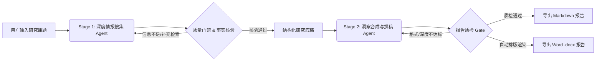

# Insight Synthesis Crew | 深度研究与咨询级报告合成智能体系统

<p align="center">
  <a href="https://www.python.org/"></a>
  <a href="https://crewai.com/"></a>
  <a href="https://www.deepseek.com/"></a>
  <a href="https://serper.dev/"></a>
  <a href="LICENSE"></a>
</p>

**Insight Synthesis Crew** 是一个基于 **CrewAI** 与 **DeepSeek-V4.1-Flash** 构建的**两阶段协同深度研究与报告合成系统**。系统通过模拟专业咨询机构的分工机制，将“广度情报搜集与多源交叉验证”与“深度逻辑综合与咨询级文档排版”解耦，内置自愈式质量门禁（Quality Gate），支持一键导出结构严谨的 Markdown 与 Word (`.docx`) 研究报告。

---

## ✨ 核心特性

- **🔄 两阶段智能体协同架构（Two-Stage Pipeline）**
  - **第一阶段（广度检索与去噪核验）**：情报检索智能体聚焦多维度信息挖掘、关键数据提取、事实交叉核验与信源记录，输出高信息密度的结构化研究底稿。
  - **第二阶段（洞察合成与咨询级撰稿）**：首席主笔智能体基于核验后的底稿，提炼核心商业/学术洞察，按麦肯锡金字塔原理完成深度报告撰写与结构化排版。
- **🛡️ 自愈式质量门禁（Self-Healing Quality Gate）**
  - 内置输出质量评估与自动重试/补偿机制，对论据完整性、信源可追溯性及格式合规性进行自动化质检，杜绝大模型“幻觉”与敷衍输出。
- **📄 双格式咨询级报告导出（Markdown & Word）**
  - 原生支持生成排版精美的 `.md` 文档，并自动渲染转换为标准咨询级 `.docx` Word 报告（含多级标题样式、参考文献表格、执行摘要高亮卡片与标准化段落排版），且在生成后自动调用系统应用打开查阅。
- **⚡ 极致性价比与高吞吐驱动**
  - 深度适配 **DeepSeek-V4.1-Flash** 模型，在保持长文本深度推理能力的同时，大幅降低多轮 Agent 交互的 Token 成本与响应延迟。
- **🧰 现代化 Python 工程规范**
  - 采用 `uv` 进行极速依赖与虚拟环境管理，配置与代码分离（`config/` + `src/`），历史报告永久沉淀（`reports/archive/`），并提供完整的单元测试套件。

---

## 🏗️ 系统工作流架构



### 最小权限隔离与安全设计原则（Least Privilege）

```
                       用户输入研究课题 (Topic)
                                  │
                                  ▼
     ┌────────────────────────────────────────────────────────┐
     │  Phase 1: Scout Agent (高级情报搜寻员)                  │
     │  • 模型: DeepSeek-V4.1-Flash (极速、长上下文)           │
     │  • 挂载工具: Google 关键词搜索 (Serper) + 网页抓取爬虫   │
     │  • 约束控制: max_iter=8, max_rpm=15, 禁止递归委派        │
     └────────────────────────────┬───────────────────────────┘
                                  │ 结构化事实证据链 & 引用来源清单
                                  ▼
                     【门禁路由质检 Quality Gate】
                    (信息丰度/来源不足则触发自愈重试)
                                  │ 质检通过
                                  ▼
     ┌────────────────────────────────────────────────────────┐
     │  Phase 2: Analyst Agent (高级战略分析与核验员)         │
     │  • 模型: DeepSeek-V4.1-Flash                           │
     │  • 严格工具隔离: 仅允许本地受控文件读取，阻断公网搜索    │
     │  • 约束控制: max_iter=5, 消除外网幻觉与发散             │
     │  • 交付规格: Pydantic 强结构化输出 (含完整参考文献表)   │
     └────────────────────────────┬───────────────────────────┘
                                  │
                                  ▼
     ┌────────────────────────────────────────────────────────┐
     │                双轨自动归档与呈现                       │
     │  1. Markdown 优雅排版 (reports/archive/ & latest)       │
     │  2. 商务级排版 Word (.docx) 并自动调用应用弹出查阅      │
     └────────────────────────────────────────────────────────┘
```

---

## 📂 完整目录结构

```
.
├── config/
│   ├── agents.yaml           # Agent 角色设定、目标、LLM 模型与限流策略
│   └── tasks.yaml            # 阶段一与阶段二任务流、上下文依赖与引用硬约束
├── src/
│   └── craw/
│       ├── __init__.py
│       ├── crew.py           # CrewBase 编排：Agent 组装、工具受限绑定与 Guardrail
│       ├── flow.py           # AdvancedTwoStageFlow：带质量门禁自愈重试的工作流
│       ├── export_docx.py    # 商务级 Word (.docx) 导出引擎与系统自动唤起
│       └── models.py         # Pydantic 报告与引用源 (CitationSource) 数据模型
├── reports/
│   ├── archive/              # 📂 历史所有课题永久归档目录 (永不覆盖)
│   │   ├── 20261022_123900_低空经济在物流配送场景.docx
│   │   └── 20261022_123900_低空经济在物流配送场景.md
│   ├── research_report.docx  # 📄 最新一次执行的 Word 报告镜像
│   └── research_report.md    # 📝 最新一次执行的 Markdown 简报镜像
├── tests/
│   ├── test_crew_setup.py    # 工具安全隔离与权限边界自动化测试
│   └── test_flow_structure.py# Flow 状态生命周期与路由逻辑验证
├── .env.example              # 环境变量与 API 密钥模版 (已脱敏)
├── LICENSE                   # MIT 开源许可证
├── main.py                   # 命令行多模式统一运行入口
└── pyproject.toml            # uv 依赖管理配置
```

---

## 🚀 快速上手

### 1. 安装与环境准备

项目使用极速包管理工具 `uv`：

```bash
# 克隆仓库
git clone https://github.com/sxxcwj/craw.git
cd craw

# 复制密钥配置模版
cp .env.example .env
```

在 `.env` 中填入您的密钥：
```env
# 核心大模型（默认 DeepSeek）
DEEPSEEK_API_KEY=your_deepseek_api_key

# 搜索引擎（阶段一 Google 全网检索，可选，推荐配置）
SERPER_API_KEY=your_serper_api_key
```

### 2. 运行架构与安全约束测试

验证 Agent 工具隔离（Analyst 绝无搜索工具、调用轮次不超过阈值等）：

```bash
uv run python tests/test_crew_setup.py
uv run python tests/test_flow_structure.py
```

### 3. 执行研究任务

系统支持三种执行模式：

#### 模式 A：自愈质检 Flow 模式（推荐 · 生产环境首选）
阶段一采集信息后自动执行门禁质检，不合格自动重试，完成后**自动将报告归档至 `reports/archive/` 并自动唤起 Microsoft Word**：
```bash
uv run python main.py --flow "2026年企业级大模型微调与 RAG 架构的选型平衡"
```

#### 模式 B：标准两阶段 Crew 线性执行
```bash
uv run python main.py "2026年全球半导体先进制程与封装技术的演进格局"
```

#### 模式 C：可视化拓扑图生成
```bash
uv run python main.py --plot
# 生成 flow_plot.html，可在浏览器中交互式查阅两阶段路由分支
```

---

## 📊 报告产出与视觉排版特色

导出的 Word (`.docx`) 报告遵循战略咨询行业排版标准：
1. **执行摘要卡片**：浅蓝背景与深蓝高亮边框；
2. **多级标题体系**：层级分明，配备适合中文阅读的 1.25 倍行距；
3. **风险警戒标记**：红色标注关键潜在风险点；
4. **行动建议指引**：绿色标号突出可操作性战略路线；
5. **四列参考文献表格**：详细罗列 `序号`、`来源机构/文献标题`、`核心论据与支撑事实`、`可访问的原始链接 URL`。

---

## 📄 开源许可证

本项目基于 [MIT License](LICENSE) 开源。
